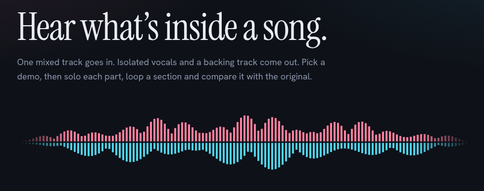

# Vocal Stem Separation

[](https://bhavikab04.github.io/Vocal_Stem_Separation/)


### 🎧 [**Try the live demo → bhavikab04.github.io/Vocal_Stem_Separation**](https://bhavikab04.github.io/Vocal_Stem_Separation/)

> The hosted page is a static showcase. To separate your own songs, run the app locally (see [Run it locally](#run-it-locally)).

<p align="center">
  
</p>


Instrument classification and vocal source separation on music mixtures using the [MoisesDB](https://arxiv.org/abs/2307.15913) dataset (80 songs, each with isolated stems). The project compares feature-based and neural classifiers, trains a Transformer spectrogram model and a Hybrid Spectrogram-TasNet from scratch, then fine-tunes a pretrained HTDemucs and serves it through a web app.

## Results at a glance

| Model | Trained | Result |
|---|---|---|
| Transformer spectrogram masker | from scratch | Log-Spec L1 0.41 → 0.034; waveform SDR negative |
| HS-TasNet-Small | from scratch | Log-Spec L1 0.034; waveform SDR negative |
| **Pretrained HTDemucs** | no training | **11.51 dB** vocal SDR (10 held-out songs) |
| HTDemucs fine-tuned on MoisesDB | 43 min on a T4 | 11.54 dB vocal SDR (+0.03 dB, within noise) |

**Takeaway:** with only ~70 training songs, the from-scratch models could not compete, and fine-tuning did not meaningfully improve an already strong pretrained model.

## Contents

- [Stage 1: Instrument classification](#stage-1--instrument-classification-baseline)
- [Stage 2: Vision Transformer separator](#stage-2--vocal-separation-with-a-vision-transformer)
- [Stage 3: Hybrid Spectrogram-TasNet](#stage-3--hybrid-spectrogram-tasnet-hs-tasnet-small)
- [Stage 4: Fine-tuning HTDemucs](#stage-4--fine-tuning-pretrained-htdemucs)
- [Stage 5: Web app](#stage-5--web-app)
- [Architecture summary](#architecture-summary)
- [Dataset](#dataset) · [References](#key-references)

---

## Stage 1 — Instrument classification (baseline)

Before separating anything, I wanted to understand the dataset. I extracted audio features (MFCCs, chroma, spectral centroid, RMS, zero-crossing rate) from each isolated stem and trained an SVM, a Random Forest and a small MLP on the same train/test split. A CNN and an R-CNN were also trained for classification, and the CNN gave the best results.

This shows which instruments are spectrally distinct. Drums were the easiest to identify, which is also why I chose **vocals** for separation: drum energy spreads across all frequencies and is hard to mask cleanly, while vocals are harmonically structured and sit in a narrower band, so a mask-based approach had more potential.

## Stage 2 — Vocal separation with a Vision Transformer

The first separator treats the spectrogram like an image. The mixture's log-magnitude spectrogram (513 frequency bins × 1024 frames, about 16 s) is cut into 27×32 patches (608 tokens), passed through a 6-layer Transformer encoder with 8-head attention, reshaped to a 2D map, upsampled bilinearly, and decoded by a small conv head into a soft mask in [0, 1].

- **Patch size (27, 32):** the usual ViT patch (9×8) would give 7,296 tokens, too many for a T4. (27, 32) brings it down to 608.
- **Log-magnitude loss:** raw L1 on spectrograms is dominated by loud low-frequency bins, so the easy solution is a near-zero mask. Working in log1p space equalises the bins.

**Results:** Log-Spec L1 improved from 0.41 to 0.03 (a 93% reduction), but SI-SDR and SDR were negative. Part of this is the phase mismatch from reconstructing with the mixture's phase. Looking back, other causes also contributed: each epoch used a single 16 s crop per song, stems were peak-normalised before mixing, and only one wav per stem folder was loaded. Stage 4 fixes these in the data pipeline.

## Stage 3 — Hybrid Spectrogram-TasNet (HS-TasNet-Small)

Motivated by Venkatesh et al. (2024): spectrogram models capture harmonic structure but not phase, waveform models handle phase but miss fine spectral detail, so a hybrid gets both.

HS-TasNet-Small runs two branches in parallel:

- **Spectrogram branch:** BiLSTM over log-magnitude frames, predicts a soft mask, reconstructed via iSTFT.
- **Waveform branch:** learned Conv1D encoder, BiLSTM masker and transposed Conv1D decoder. A Hanning window on the decoder filters avoids discontinuities at chunk boundaries (a trick from the paper).

The branches are combined by summation rather than concatenation (the "Small" variant, about 16M parameters instead of 42M).

**Why BiLSTM instead of a Transformer?** With 80 songs a Transformer's data appetite is a problem. Rouard et al. (2022) found Hybrid Transformer Demucs only beats Hybrid Demucs when trained with 800+ extra songs, whereas BiLSTMs have a track record on MUSDB-sized data (86 training songs).

**Multi-domain loss:** log-spectral L1 plus waveform L1, with the waveform term ramped up over the first 10 epochs so the spectrogram branch stabilises first.

## Stage 4 — Fine-tuning pretrained HTDemucs

Both from-scratch models struggled at this data scale, so I fine-tuned the pretrained HTDemucs ([Rouard et al., 2022](https://arxiv.org/abs/2211.08553)) using `finetune_vocals.py`.

- **Data pipeline:** MoisesDB stems are grouped into HTDemucs's four sources (vocals, drums + percussion, bass, other), and every wav in a stem folder is summed. Samples are random 7.8 s stereo crops at 44.1 kHz with gain, polarity and channel-swap augmentation. Half of the samples are remixes of stems from different songs.
- **Training:** AdamW, learning rate 3e-5 with cosine decay, mixed precision, 12 epochs × 60 steps, effective batch 8 (micro-batch 1 with gradient accumulation 8 to fit a T4). Waveform L1 loss with vocals weighted 3×. About 43 minutes on one T4.
- **Evaluation:** 10 songs held out; vocal SDR on 30 s vocal-heavy excerpts, pretrained vs fine-tuned.

| Model | Held-out vocal SDR |
|---|---|
| Pretrained HTDemucs | 11.51 dB |
| Fine-tuned on MoisesDB | 11.54 dB |

The 0.03 dB gain is within noise for a 10-song validation set (and the best epoch was picked on the same songs), so fine-tuning on ~70 songs does not meaningfully improve the pretrained model. The app uses the pretrained weights by default; a fine-tuned checkpoint can be dropped in as `htdemucs_vocals_ft.pt`.

## Stage 5 — Web app

A FastAPI backend (`server.py`) runs HTDemucs and a single-page front end (`static/index.html`) lets you upload a song and get vocals and an instrumental back. The page shows upload progress and a synced three-track player (original, vocals, instrumental) with waveforms, solo/mute/volume per track, looping and downloads.

### Run it locally

1. Install Python 3.10+ and ffmpeg (`winget install ffmpeg` / `sudo apt install ffmpeg` / `brew install ffmpeg`).
2. Windows: double-click `run.bat`. Linux/Mac: `bash run.sh`.
3. Open <http://localhost:8000>.

The first launch downloads the pretrained model (internet needed). On a CPU a full song takes several minutes, so try a 30-second clip first.

## Architecture summary

| | Transformer | HS-TasNet-Small |
|---|---|---|
| Input | Log-magnitude spectrogram | Log-mag spec + raw waveform |
| Core | 6-layer Transformer encoder | 2× BiLSTM (one per branch) |
| Output | Soft mask → iSTFT | Spec mask + waveform estimate |
| Parameters | ~8M | ~16M |
| Phase handling | Mixture phase (approximation) | Waveform branch (implicit) |
| Log-Spec L1 | 0.034 | 0.034 |

## Key references

- Venkatesh et al. (2024), *Real-Time Low-Latency Music Source Separation Using Hybrid Spectrogram-TasNet*
- Rouard et al. (2022), *Hybrid Transformers for Music Source Separation*
- Im et al. (2022), *Neural Vocoder Feature Estimation for Dry Singing Voice Separation*
- Stöter et al. (2019), *Open-Unmix: A Reference Implementation for Music Source Separation*
- Pereira et al. (2023), *MoisesDB: A Dataset for Source Separation Beyond 4-Stems*

## Dataset

[MoisesDB](https://zenodo.org/record/10520051): 80 songs with isolated stems, uploaded to Kaggle as a private dataset. Each song folder contains per-instrument subdirectories with `.wav` files, loaded directly from the file structure with no extra library.

- **Stages 2–3 (from scratch):** audio resampled to 16 kHz mono, STFT with n_fft=1024 and hop=256 (about 16 ms per frame), about 16 s per example (MAX_LEN=1024 frames).
- **Stage 4 (HTDemucs):** 44.1 kHz stereo, 7.8 s crops.

## Citation

```bibtex
@misc{pereira2023moisesdb,
      title={Moisesdb: A dataset for source separation beyond 4-stems},
      author={Igor Pereira and Felipe Araújo and Filip Korzeniowski and Richard Vogl},
      year={2023},
      eprint={2307.15913},
      archivePrefix={arXiv},
      primaryClass={cs.SD}
}
```